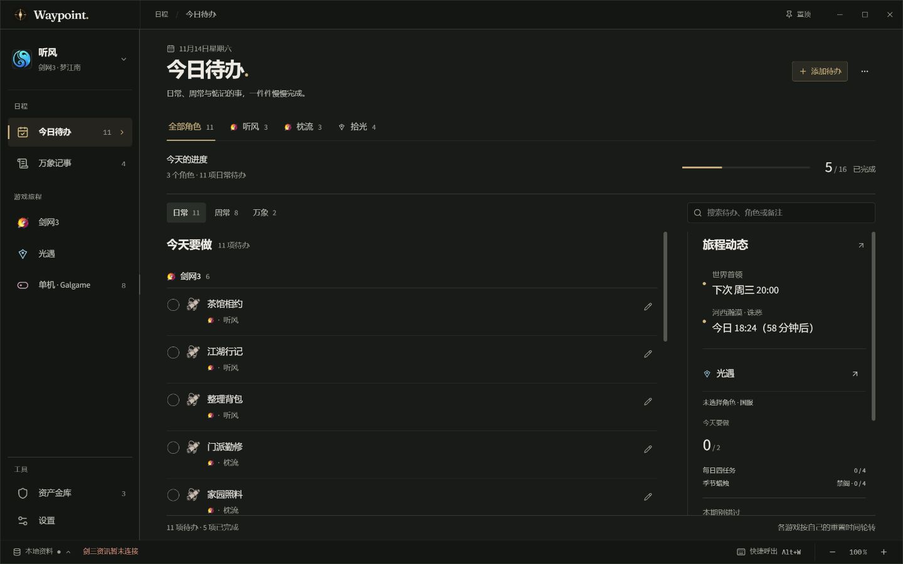
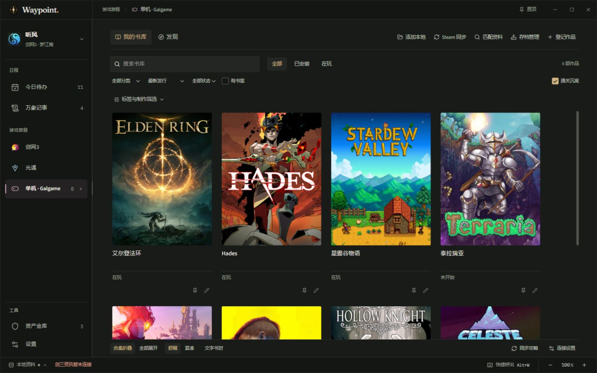
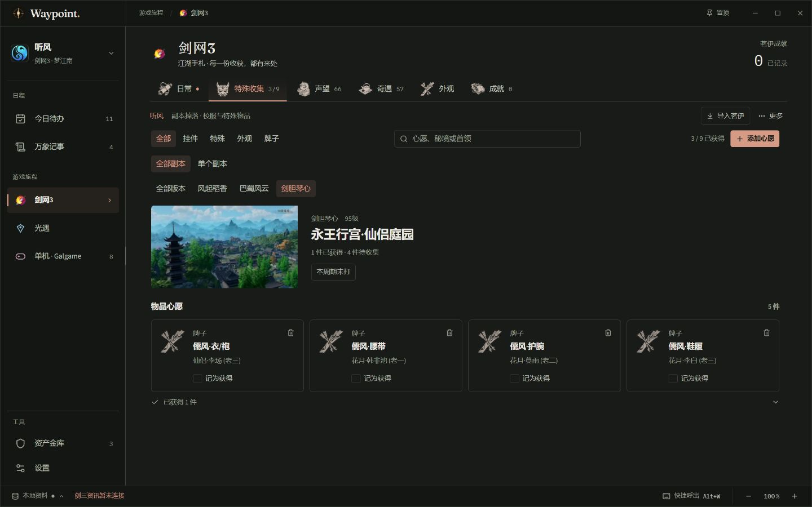
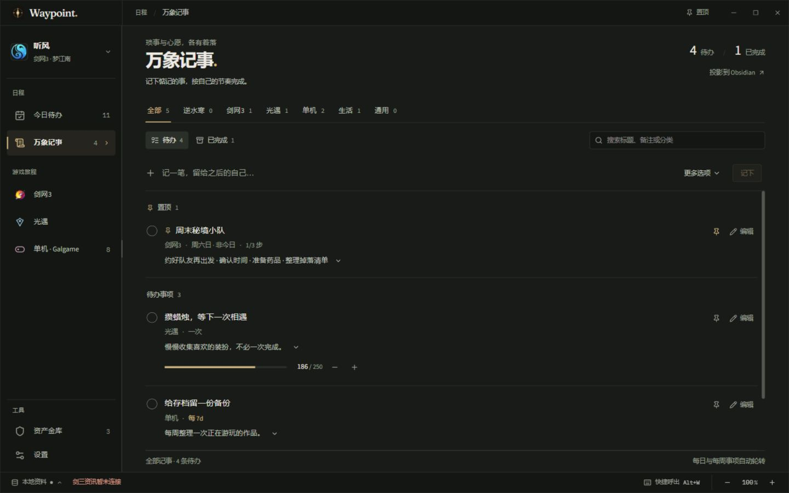
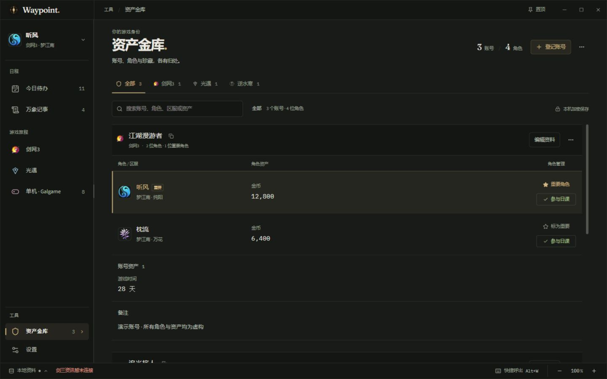

# Waypoint（道标）

Windows 桌面游戏工作台，集中管理多角色日课、光遇收集、剑网 3 图鉴、单机书库、攻略和账号金库。使用 Tauri 2、Vue 3、TypeScript、Tailwind CSS 4 和 Rust，用户数据保存在本机 SQLite。



截图来自浏览器演示预览，账号、角色、任务、资产及游玩进度均为虚构；游戏封面与公共目录资料来自对应资料源。

## 功能

- **今日待办**：按角色管理日常、周常和周期记事，按游戏复位时间刷新。
- **剑网 3**：日历、特殊收集、声望、奇遇、成就及外观；支持读取本机茗伊成就快照，切换页面保留该游戏所选角色。
- **光遇**：今日任务、活动、收藏、探索和外观；角色进度分别保存，旧共享记录由用户选择归属后合并。
- **单机书库**：本地与 Steam 导入、作品资料、攻略阅读、影音、游玩时长、存档备份与画面缩放。
- **万象记事与金库**：保存周期备忘、账号名册及角色资产。
- **备份**：本地及 WebDAV 密码加密备份，包含数据库和图片缓存，支持恢复及撤销上次恢复。

网络资料、图片和价格依赖对应服务的可用性。缺失或无法确认的数据会保留提示；Steam 成就来自官方记录，不从本地存档推断。浏览器预览使用独立 localStorage，无法替代桌面端的文件、凭据和系统能力。

## 界面预览

| 单机书库 | 剑网 3 收集 |
| --- | --- |
|  |  |
| **万象记事** | **资产金库** |
|  |  |

## 运行客户端

Windows x64 构建产物：

- `src-tauri/target/release/waypoint.exe`：直接运行。
- `src-tauri/target/release/bundle/nsis/Waypoint_0.1.0_x64-setup.exe`：安装包。

首次安装没有演示账号、角色、任务或私人攻略。关闭主窗口会最小化到托盘，彻底退出请使用托盘菜单。

默认快捷键为 `Alt+W` 显示主窗口、`Alt+M` 打开「记一笔」，可在设置中修改。

## 开发与构建

需要：

- Windows 10/11 x64、WebView2 Runtime。
- Node.js 24、pnpm 10、Rust stable（MSVC 工具链）。依赖版本以两个 lockfile 为准。
- Visual Studio 2022 C++ Build Tools、Windows SDK 10.0.26100.0。
- Python 3，`py`、`python` 或 `python3` 可从 PATH 调用。

```powershell
pnpm install --frozen-lockfile
pnpm tauri dev
```

前端独立预览：

```powershell
pnpm dev
```

开发地址为 `http://localhost:1420`。原生缩放组件首次构建会在 `src-tauri/target/scaling` 下载固定版本依赖并编译；需要访问 NuGet 和 Conan 依赖源。后续构建复用缓存。

用于截图的演示预览：

```powershell
pnpm demo
```

命令会打开 [演示工作台](http://waypoint-demo.localhost:1422/demo.html)。此入口仅供开发使用，不进入正式客户端构建；专属本地域名的 localStorage 与普通预览、桌面端 SQLite 分开。每次刷新恢复虚构样例，不读取私人数据库、凭据或本机游戏目录。若该地址已存在没有演示标记的数据，会停止加载并保留原数据。书库封面与部分游戏资讯需要联网，原生文件、备份及系统操作仍需桌面客户端。

正式构建：

```powershell
pnpm release
```

`release` 统一重映射 Rust、C/C++ 和原生依赖中的编译路径，并检查主程序与缩放载荷，防止泄漏开发机用户名和源码目录。产物位置见上节。

验证命令分别执行：

```powershell
pnpm test
pnpm build
cargo test --manifest-path src-tauri/Cargo.toml --lib -- --skip credential_roundtrip --test-threads=1
```

`credential_roundtrip` 会操作 Windows 凭据管理器；默认命令跳过它。显式标记 ignored 的在线测试需要另行选择运行。

## 数据与换机

桌面数据位于 `%APPDATA%/com.waypoint.app/`。`waypoint.db` 保存用户数据，`cache.db` 是可重新获取的网络缓存。金库敏感字段由 Windows DPAPI 加密；WebDAV 密码、Steam Web API Key 和其他服务令牌保存在 Windows 凭据管理器，不随完整备份迁移。

1. 在旧电脑的设置中填写至少 10 个字符的备份密码，导出 `.wpbak` 或上传到 WebDAV。
2. 单独保管密码；应用不保存它，遗失后无法恢复。
3. 在新电脑安装客户端，输入原密码导入备份或从云端恢复。恢复前会验证完整性和账号可读性，并保留回滚点。
4. 重新填写本机服务凭据，并选择 Obsidian 仓库、游戏目录及剑三插件目录。
5. 核对角色、任务、收集和金库内容后，再刷新网络数据。

完整备份通过 SQLite 在线快照包含已提交的 WAL 数据，包含账号、任务、记事、游戏档案、设置、进度、Steam 库及封面与图标缓存。游戏程序、外部游戏存档、下载文件、Obsidian 仓库和剑三插件快照需要另行复制。旧 `.db` / `.db.gz` 仅在金库密文仍可读取时导入；跨机迁移应先在原电脑转为 `.wpbak`。

WebDAV 上传先写临时文件并校验，再替换云端版本；服务器需要支持 MOVE。连续两分钟无传输进展或服务器确认时停止，不用未完成文件覆盖原备份。云端版本冲突需明确确认覆盖。恢复及撤销恢复会保留本机已有 WebDAV 连接和凭据。

## 源码结构

| 目录 | 内容 |
| --- | --- |
| `src/pages`、`src/components` | 页面与交互组件 |
| `src/workspace` | 页面状态、初始化与工作流 |
| `src/services` | IPC、持久化和领域解析 |
| `src/content`、`src/data`、`public` | 公共目录、图标和静态资源 |
| `src-tauri/src` | Rust 命令、SQLite、备份及系统能力 |
| `src-tauri/native/scaling` | 独立缩放进程与对应源码、许可证 |
| `addons` | 剑三外观采集插件 |
| `docs/Waypoint_Design_Specification.md` | 数据边界与模块入口 |

## 清理与源码分发

仅提供经过检查的源码快照或客户端产物。不要压缩整个开发目录：`com.waypoint.app/` 可能含私人数据库，`scratch/` 可能含调试截图与样本；数据库、备份、凭据、调试产物、依赖和构建输出均已列入忽略规则。源码快照不包含旧 `.git` 历史。

预览及执行构建缓存清理：

```powershell
powershell -NoProfile -ExecutionPolicy Bypass -File .\cleanup-build.ps1 -WhatIf
powershell -NoProfile -ExecutionPolicy Bypass -File .\cleanup-build.ps1
```

脚本只处理本项目 `src-tauri/target` 中的可重建输出，保留默认 release、正在运行客户端的 EXE 与安装包、原生缩放载荷和签名，并核对 SHA-256。构建锁占用、越界路径及目录链接会阻止清理。额外保留构建可加 `-KeepBuild release,构建名`。脚本不删除个人数据库、外部笔记或游戏文件。

## 第三方内容

画面缩放使用 Magpie 0.12.1 核心，独立进程及宿主按 GPL-3.0-or-later 提供；上游提交、源码和许可证见 [缩放组件说明](src-tauri/native/scaling/NOTICE.md)。其他依赖使用其各自许可证。

游戏图片、图标与目录来自官方及社区资料源，相关权利与使用条件归原提供方。主项目许可证尚未确定；整理源码不表示已授予新的开源许可。
